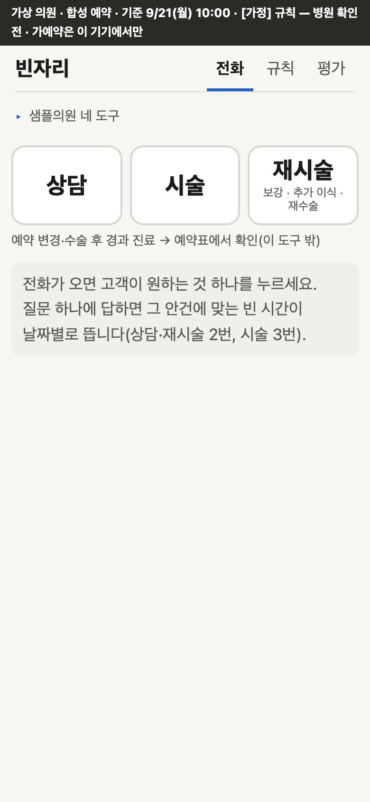
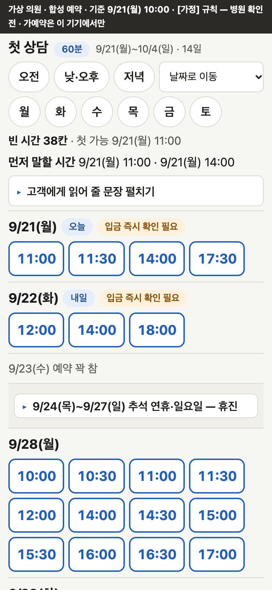
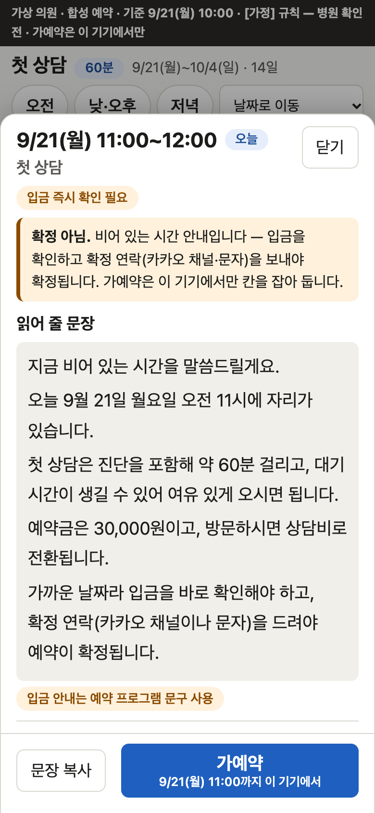

# 빈자리

예약 전화가 오면 안건 버튼(상담 · 시술 · 재시술)과 확인 질문 하나만 눌러, 그 안건에 맞는 빈 시간을 날짜별로 띄우고 고객에게 읽어 줄 문장까지 만들어 주는 도구입니다. 가상 의원 '샘플의원'과 합성 예약으로 만든 시연이고, 예약 확정은 사람이 합니다.

**시연:** https://binjari-clinic.vercel.app (배포 예정)

| ① 첫 화면 | ② 빈 시간 목록 | ③ 읽어 줄 문장·가예약 |
|---|---|---|
| [](docs/screens/1-start.png) | [](docs/screens/2-slots.png) | [](docs/screens/3-sheet.png) |
| 전화가 오면 안건 하나를 누릅니다 | 상담 → "예, 처음" 두 번에 날짜별 빈 시간. 추석 휴진은 한 줄로 | 시간을 누르면 읽어 줄 문장과 가예약 |

## 화면

- **전화 받기**: 큰 버튼 셋 → 질문 하나 → 날짜별 빈 시간과 "먼저 말할 시간" 두 칸. 칸을 누르면 읽어 줄 문장·확정 문자 틀·가예약이 있는 시트가 올라옵니다.
- **규칙 보기**: 계산에 쓰는 값과 볼트 문서 원문.
- **평가**: 규칙 위반 검사, 별도 구현 대조, 경계 사례, 결정성. 하지 않은 것은 "미실시"로 적습니다.

## 기능

- 상담·재시술은 2번, 시술은 3번 누르면 빈 시간이 뜹니다. 처음 오는 분은 첫 상담으로 바꾸고 까닭을 보입니다. 재시술은 수술이 아니라 의료진 재진 상담으로 잡습니다[가정].
- 점심·접수 마감·목요일 야간·토요일·공휴일·임시 휴진, 사람·방 수, 하루 최대, 가예약을 모두 따집니다. 휴진은 "9/24(목)~9/27(일) 추석 연휴·일요일 — 휴진" 한 줄로 건너뛰고, 누르면 "…휴진입니다. 가장 가까운 빈 시간은 …" 문장이 나옵니다.
- 요일·시간대·날짜로 한 번 거르면 목록과 제안 칸이 함께 바뀝니다("다음 주 목요일 저녁 돼요?").
- 읽어 줄 문장은 "비어 있는 시간 안내"이고, 확정 조건(예약금 안건은 입금 확인 뒤 확정 연락)을 한 문장으로 붙입니다.
- 가예약은 이 브라우저에만 남고 모든 안건 계산에서 칸을 차지합니다. 예약 프로그램에 옮길 한 줄을 복사합니다.

## 믿을 수 있게 만든 장치

- AI를 부르지 않는 결정적 계산입니다. 규칙 값은 볼트 문서의 json에서만 읽고, 문서가 깨지면 빈 시간을 내지 않고 "규칙 오류 — 예약표에서 직접 확인"으로 멈춥니다.
- 앱 코드를 쓰지 않는 파이썬 계산기가 모든 시작 후보를 따로 판정하고, 시험이 엔진과 한 행씩 비교합니다.
- 규칙을 일부러 틀리게 바꾼 변이를 시험이 잡는지 봤습니다. 시간대 결함 하나는 UTC 실행에서만 잡혀 `test:tz`를 둡니다.

## 숫자

- 별도 구현 대조: 기준 시각 5 × 안건 6의 후보 3,580행이 판정·까닭까지 모두 일치(빈 칸 779)
- 규칙 위반 0건: 기준 시각 2,215개 × 안건 6에서 앱이 낸 칸 335,936개를 11개 규칙으로 검사
- 변이 42개 중 42개를 시험이 잡음(처음 39개 → 시험 4개 추가)
- 시험 422개, 한국·UTC·로스앤젤레스 시간대에서 모두 통과

## 실행

```bash
npm install
npm run dev        # http://localhost:3000
npm run verify     # 시험 + 타입 + lint + 빌드
npm run test:tz    # UTC·로스앤젤레스 시간대에서 시험
```

## 한계

- 칸 규칙(소요 시간 단계, 사람·방 수, 하루 최대, 가예약 유지 기간 등)은 병원 확인 전의 [가정] 값이고, 대조 계산기도 같은 AI가 같은 문서로 짜서 해석 실수는 못 잡습니다.
- 실제 예약 프로그램과 이어지지 않고, 가예약은 이 기기에서만 보입니다. 기준 시각 바꿔 보기 화면은 아직 없습니다.
- 375×667 화면에서 첫 칩 줄이 스크롤 없이 보이는 것은 상담뿐입니다. 한창구 문의함의 추석(9/24) 예약과는 어긋납니다.

## 자세히

- [PRD](docs/PRD.md) — 요구사항, 규칙 값 표, 잰 값(7.1절), 병원에 물을 질문
- [합성 데이터와 대조 계산기](data/README.md) — 생성 규칙, 심은 경계 사례
- [예약 칸 규칙](vault/booking-slots.md) — [가정] 값과 근거

Next.js 15(정적 내보내기) · React 19 · TypeScript · vitest.
코드는 AI 코딩 도구(Claude Code)와 함께 만들었습니다.
